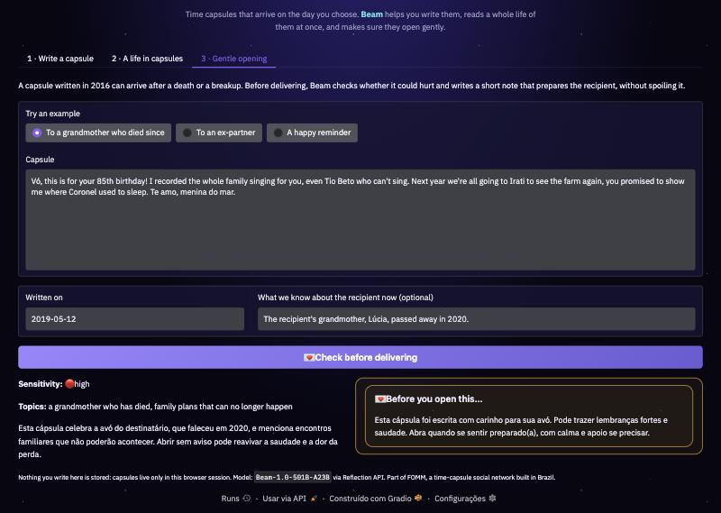
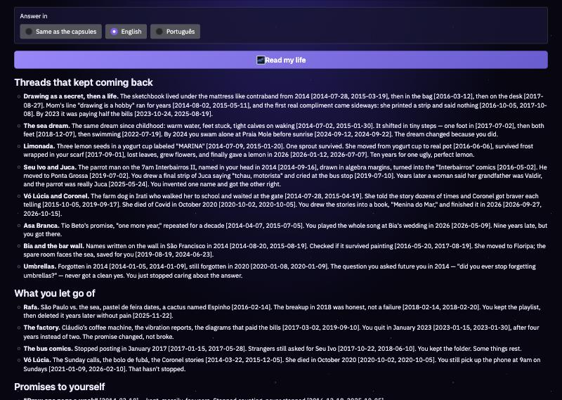

# FOMM · fear of missing memories

**FOMM ("fear of missing memories")** is a time-capsule social network built in Brazil: you record a video,
an audio or a letter, pick a date, and it is delivered to someone on that day, next month or in ten years.

This Space is the part of FOMM that only a model like **Beam** makes possible. Beam does three jobs:

| Tab | What Beam does | Why Beam |
|---|---|---|
| **1 · Write a capsule** | Interviews you one question at a time, then writes the capsule **in your own voice**, from your own details. | Most people freeze in front of "write to yourself in 10 years". A good interviewer gets real, specific memories out. |
| **2 · A life in capsules** | Reads **every capsule a person wrote over the years in a single pass** and writes a retrospective: recurring threads, what they let go of, and which promises to their future self they kept, broke or left open, all cited by date. | Beam's **1M-token context**. A heavy user of FOMM writes hundreds of thousands of tokens across a decade. No chunking or RAG: the whole life is in the context, so Beam can connect a promise from 2014 to the capsule that kept it in 2022. |
| **3 · Gentle opening** | Before a capsule written years ago is delivered, Beam judges whether it could hurt now (a grandparent who died, an ex-partner) and writes a short note that prepares the recipient without spoiling it. Returns structured JSON. | Time capsules are uniquely risky: the author could not know the future. This is a real safety feature for a real product. |

**72-second demo** (tab 2 reading the 480k-token life live, then tab 3):

<video src="https://huggingface.co/spaces/anagirio/fomm-letters-to-the-future/resolve/main/assets/demo.mp4" controls width="100%"></video>

[Watch the demo video](assets/demo.mp4)





Try tab 2 with the built-in sample life of **Marina** (a fictional person, synthetic data written for this demo):

- **74 hand-written capsules, 2014–2026.** Small details are planted years apart on purpose: a lemon seed
  planted in a yogurt cup in 2016 gives its first lemon in 2026; a promise to learn "Asa Branca" on the guitar
  is kept nine years late; the old man with a parrot she drew on the bus in 2014 turns out, in 2025, to have a
  real name. Would you notice them all? Beam has to.
- **Long life, expanded with Beam: 5,112 capsules, about 480k tokens.** [`make_long_life.py`](make_long_life.py)
  uses Beam to grow the hand-written skeleton into thousands of everyday capsules around it. The planted
  details become needles in a much bigger haystack. The app reads all of it in a single request.

## Measured: can Beam find the planted details in a 480k-token life?

[`needle_test.py`](needle_test.py) runs two tests, both **graded by code, no AI judge**. Every answer, the full
retrospectives and token counts are in [`results/needles.json`](results/needles.json). The whole life, the
questions with their answers and the results are also a dataset, so you can run the same test on any model:
**[anagirio/fomm-marina-life](https://huggingface.co/datasets/anagirio/fomm-marina-life)**.

**1. Questions.** 16 short questions whose answers are only in the hand-written capsules, many of them only by
connecting capsules years apart ("What was the parrot man's real name?" is answered 11 years after she drew him).

| Life | Prompt tokens | Effort | Correct (3 runs) | Time |
|---|---|---|---|---|
| no capsules (control) | 470 | low | 0/16 | 3 s |
| 74 hand-written capsules | 7.8k | low | 16/16 · 16/16 · 16/16 | 4 s |
| 5,112 capsules | **480k** | low | **15/16 · 15/16 · 14/16** | 18 s |
| 5,112 capsules | 480k | medium | 13/16 · 15/16 · 13/16 | 28 s |

**Every wrong answer traces back to the haystack, not to Beam's reading.** The filler that Beam itself generated
contradicts the skeleton in places despite the instructions: it repeats the failed driving test several times
(so "how many driving tests?" becomes 9 instead of 3), plants the lemon seeds in 2014–2015 instead of 2016, and
writes more than one "first lemon". That is a second finding: as a generator, Beam drifts from the facts it is
told to keep.

**2. Retrospective, no hints.** The app's own tab-2 prompt, which doesn't say what to look for. We check which of
6 planted loops it closes on its own, and whether each date it cites exists.

| Life | Effort | Loops closed | Cited dates that don't exist | Empty answers |
|---|---|---|---|---|
| 74 capsules (7.8k tokens) | medium | 5/6 · 4/6 · 4/6 | 0 of 223 | 0 of 3 |
| 5,112 capsules (480k tokens) | low | 6/6 · 4/6 · 3/6 · 4/6 · 3/6 | 4 of 375 (1%) | 0 of 5 |
| 5,112 capsules (480k tokens) | medium | 3/6 · 3/6 · empty | 2 of 130 | **1 of 3** |

- The big loops (swimming, "Asa Branca", the book) are found almost every time; the subtle ones (the parrot
  man's real name, the dream where she swims with her grandmother) are missed more often, even in the short life.
- **The budget trap on long inputs.** At 480k tokens, `medium` effort sometimes thinks until the token limit and
  returns nothing (in an earlier run with a smaller budget, 2 of 3 came back empty and the third degenerated into a
  list of 1,400 dates). `low` answered 5 of 5, in 15 s instead of 37 s. So the app switches to `low`, doubles the
  reasoning budget and retries once for lives over ~100k tokens.
- **Lost in dates.** That degenerate list also showed up once in the live app. The app now keeps at most three
  dates of any run it cites, and if Beam lists more than 30 in a row it stops the stream and tries once more.
- The first version of the loop grader also required exact dates; the filler moves some dates, so loops are now
  checked by how they end. Both gradings are saved in the JSON.

## Is reading the whole life worth it? Whole life vs RAG, and context length

[`context_test.py`](context_test.py) asks the obvious follow-up questions, with the same questions, loops and
grading (by code). Raw results: [`results/context.json`](results/context.json).

**RAG ties on direct questions.** RAG retrieves the capsules that look most like each question (dense:
`multilingual-e5-large`; sparse: BM25) and asks Beam one question at a time, same prompt, `low` effort.

| How Beam sees the life | Prompt tokens | 16 questions, 3 runs |
|---|---|---|
| **whole life, one request** | 480k (once) | 15 · 15 · 14 |
| RAG, BM25 top-50 | ~4.8k per question | 15 · 15 · 15 |
| RAG, dense top-100 | ~9.5k per question | 15 · 14 · 15 |
| RAG, dense top-20 | ~2k per question | 11 · 11 · 11 |

A direct question has words to search with, so good retrieval finds the evidence; with only 20 capsules it misses
the parrot man's name and age and the first lemon.

**RAG fails at what FOMM is for.** A retrospective has no question: the point is to find what came back years
later without being told. RAG has to guess a query ("promises to my future self, things that came back years
later, recurring people, objects, songs, plants and dreams…"). Same retrospective prompt, same loop grader:

| Planted loop | RAG, 12 runs (top-100 / top-300, dense / BM25) | Whole life, 5 runs |
|---|---|---|
| lemon seed (2016) → first lemon (2026) | **0** | 3 |
| parrot man drawn (2014) → real name Valdir (2025) | **0** | 2 |
| book about Vó → *Menina do Mar* finished | **0** | 4 |
| "Asa Branca" promise → kept in 2023 | 11 | 5 |
| learn to swim → 25 m | 6 | 5 |
| sea dream → swimming with Vó in it | 5 | 1 |
| **loops per run** | **1–2 of 6** | **3–6 of 6** |

The three most subtle loops never appear with RAG, even with 300 capsules (~29k tokens): the capsules that close
them don't look like any query you would write in advance. That is the case for long context.

**Context length: no drop until ~120k, then the haystack's contradictions show.** The 74 hand-written capsules
plus a growing random sample of the filler (each life contains the smaller ones):

| Capsules | Prompt tokens | `low`, 3 runs | `medium`, 3 runs | Of the 13 clean questions |
|---|---|---|---|---|
| 314 | 30k | 16 · 16 · 16 | 16 · 16 · 16 | all correct |
| 634 | 59k | 16 · 16 · 16 | 16 · 16 · 16 | all correct |
| 1,274 | 119k | 15 · 16 · 15 | 15 · 15 · 15 | all correct |
| 2,554 | 239k | empty · 13 · 15 | 15 · 15 · 15 | 11–13 |
| 5,112 | 480k | 15 · 15 · 14 | 13 · 15 · 13 | 12–13 (from `needle_test.py`) |

The one question that keeps failing is "how many times did Marina take the driving test?", and the wrong answer
grows with the filler: 4 at 119k, 5–6 at 239k, 9 at 480k. Capsules about the driving test go from 4 (all
hand-written) to 14, 30 and 52 as filler is added: Beam is counting the extra tests the filler invented, not losing
track. One `low` run at 239k thought for 33,500 tokens and returned nothing: the budget trap shows up at `low` too.

## How Beam is used

- Model: [`reflection/Beam-1.0-501B-A23B`](https://huggingface.co/reflection/Beam-1.0-501B-A23B), called through
  either through the [Reflection API](https://developers.reflection.ai) (OpenAI-compatible) or
  [Hugging Face Inference Providers](https://huggingface.co/docs/inference-providers), both with
  `huggingface_hub.InferenceClient` (`chat.completions`, streaming).
- Four system prompts, one per job, are in [`prompts.py`](prompts.py). The API call, streaming and usage limits are in [`beam.py`](beam.py).
- Reasoning: Beam thinks before it answers, and the thinking counts against the token limit. Each job sets
  `reasoning_effort` (`low` for the interview, so questions come back fast; `medium` for the rest) and gets extra
  room for reasoning. At the default effort, reading a whole life could use up the entire budget thinking.
- Multi-turn: Beam's API asks for the previous turns' `reasoning_content`. The interviewer sends the whole
  interview as one transcript in a single user message instead, so every call is stateless.
- Long context: capsules are sent as `<capsule n written opens to>` blocks, sorted by date; the demo accepts up to
  about 670k tokens per request (measured: about 3 characters per token for this mix of English and Portuguese).
- Reasoning effort by input size: `medium` for a normal life, `low` with double the reasoning budget and one retry
  for a long one (see the measurements above).
- Structured output: the gentle-opening check asks for strict JSON (`sensitivity`, `topics`, `why`, `opening_note`)
  and the UI renders it as a badge and a sealed-envelope preview.
- Multilingual: users can write in any language (FOMM's users write in Portuguese); Beam answers in the user's language.

## Privacy and safety

- Nothing is stored. Capsules live only in the browser session (`gr.State`) and disappear on refresh.
- The real FOMM app (accounts, payments, ID verification) is **not** part of this Space; only the Beam features are.
- Usage limits protect the host's credits: `BEAM_SESSION_LIMIT` calls per session (default 25) and
  `BEAM_DAILY_LIMIT` per day (default 600).

## Where it runs

All the code is in this repository. The Gradio app itself runs on [Render](https://fomm-letters-to-the-future.onrender.com)
(free plan, see [`render.yaml`](render.yaml)) because it needs a server to keep the Beam API key secret, and this
Space shows it embedded. If nobody used it for a while, it takes about a minute to wake up.
Code mirror: [github.com/anagirio/fomm-letters-to-the-future](https://github.com/anagirio/fomm-letters-to-the-future).

## Run it yourself

```bash
pip install -r requirements.txt
REFLECTION_API_KEY=xxx python app.py   # or HF_TOKEN=hf_xxx
```

Without a key the app starts in a clearly-labelled **demo mode** with canned answers, so you can look at the UI
without spending credits.

| Variable | Default | |
|---|---|---|
| `REFLECTION_API_KEY` | none | Key from platform.reflection.ai. Used first if set (Space secret) |
| `HF_TOKEN` | none | Or a Hugging Face token with Inference Providers permission (Space secret) |
| `BEAM_MODEL` | `reflection/Beam-1.0-501B-A23B` | |
| `BEAM_PROVIDER` | `auto` | e.g. `baseten` |
| `BEAM_SESSION_LIMIT` / `BEAM_DAILY_LIMIT` | `25` / `600` | |

## Files

```
index.html          The Space page (embeds the app running on Render)
render.yaml         How Render runs the app
app.py              Gradio UI and the three features
beam.py             Beam client, streaming, limits, demo mode
prompts.py          System prompts
style.css           FOMM look (dark space, stars, Earth)
make_long_life.py   Uses Beam to expand the sample life into thousands of capsules
needle_test.py      Measures whether Beam finds the planted details (graded by code)
context_test.py     Whole life vs RAG, and accuracy by context length
results/            Every answer and retrospective from needle_test.py and context_test.py
assets/             Screenshots and the demo video
samples/            Synthetic life of Marina (hand-written + Beam-expanded) and sensitive examples
```

Built for the **Build with Beam** competition by Reflection AI. License: Apache 2.0.
